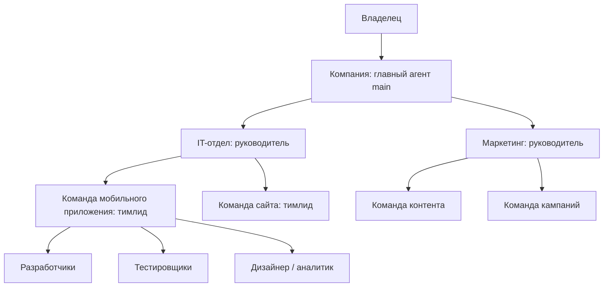
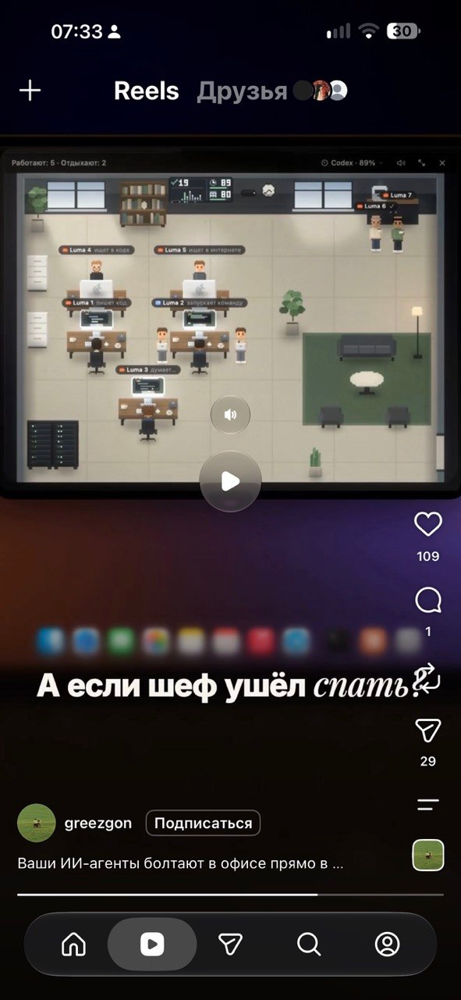

# Режим «Компания»: отделы, команды, доступ к данным и интерактивный офис

Дата: 18.10.2026. Статус: ТЗ для поэтапной реализации; описанные ниже новые возможности ещё не реализованы.

## 1. Цель и границы

Владелец управляет компанией через главного агента, создаёт отделы с руководителями, внутри отделов — команды по продуктам и проектам. Команды состоят из руководителя и исполнителей. Агенты выполняют свою работу, запрашивают недостающие данные и передают нерешённые вопросы вверх по структуре. Владелец отвечает в панели или Telegram.

Внутри команды по умолчанию открыт обычный список агентов и задач. Дополнительно включается интерактивный офис: персонажи показывают реальные действия, ожидание, проблемы и завершение работы. Переключение представления не запускает задачи и не меняет их выполнение.

Это развитие существующего режима компании, а не отдельная установка. Сохраняются Vue, Fastify, SQLite, OpenClaw, текущие подключения и desktop/server-варианты. Личный режим продолжает работать.

Дополнено 18.10.2026 по уточнениям владельца: отдел и команда необязательны для отдельного агента; проект может создаваться без GitHub, в новой или уже существующей разрешённой папке. Подробный мастер проектов, выбор технической основы и защита бизнес-правил вынесены в [отдельное ТЗ по созданию проектов](company-project-creation-and-business-rules.md). Это связанная часть развития компании, а не требование сначала реализовать весь мастер перед отделами.

Одна установка остаётся одной компанией с одним человеком-владельцем. Вход сотрудников с разными административными правами — отдельное расширение. В первой версии не нужны бесконечные вложенные отделы, несколько компаний в одном Gateway, 3D, экономика игры или автономные бесконечные совещания агентов.

## 2. Что уже есть в проекте

| Область | Подтверждено в коде | Что требуется добавить |
| --- | --- | --- |
| Компания | `SpaceService`, режим `company`, главный агент `main` | Общий экран организации и её политика |
| Команды | `TeamService`: GitHub-репозиторий, PM/developer/reviewer, папка документов, Telegram-темы | Отделы, руководители, команды без обязательного репозитория, произвольные роли |
| Агенты | `agents.parentId`, `teamId`, профили, шаблоны, настройки ИИ | Явные назначения руководителей, организационная принадлежность, проверка связей |
| Данные | `dataSources`, `agentSourceGrants` с read/write/scope | Исполняемые ограничения и запросы доступа по структуре компании |
| Связь | Ограниченный ask-main, настройка межагентных инструментов | Адресуемые обращения к руководителям и продолжение заблокированных задач |
| Одобрения | Сервис одобрений OpenClaw | Отдельные бизнес-запросы документов/доступов; не смешивать с разрешением exec |
| Telegram | Привязки ботов, групп и тем | Маршрутизация запросов владельцу, защищённые решения и единая история |
| Состояния | Gateway events, сессии, история запусков | Проекция реального состояния задачи/агента и интерактивное отображение |
| Память | Локальная память доступна и в режиме компании | Проверка изоляции памяти и индексов между командами |

Основные места изменения: `packages/shared/src/teams.ts`, `apps/bff/src/db/schema.ts`, `apps/bff/src/teams/team-service.ts`, `apps/bff/src/provision/create-agent.ts`, `apps/bff/src/provision/agent-communication.ts`, `apps/bff/src/sources/sources-service.ts`, `apps/bff/src/telegram/telegram-service.ts`, `apps/web/src/views/TeamsView.vue`, `deploy/plugins/`.

Наличие строки grant в БД или текста в AGENTS.md само по себе не доказывает изоляцию. Перед включением корпоративного доступа нужны отрицательные проверки реальных инструментов, файлов, памяти и подключений. Поддержку конкретных событий и ограничений OpenClaw 2026.8.1 необходимо подтвердить отдельным исследованием, не придумывая RPC.

## 3. Структура организации

Компания, отдел и команда — организационные сущности, а не агентные сессии. Руководитель — назначенный агент. Переименование отдела не пересоздаёт агента и не меняет его ID.

- В компании один главный агент `main`; при входе в режим компании он используется повторно.
- В отделе несколько команд, один активный руководитель; черновик отдела допустим без него.
- В команде несколько исполнителей, один активный тимлид; черновик допустим без него.
- В первой версии агент имеет одно основное назначение: компания, отдел или команда. Общие специалисты работают через адресуемые запросы, а не через скрытое членство сразу во всех командах.
- Отдел и команда при создании агента необязательны. Без них агент работает на уровне компании и обращается к `main`; агент отдела без команды — к руководителю отдела. Самостоятельный агент не обязан вступать в фиктивную команду.
- Руководитель отдела не является одновременно отдельным клоном главного агента компании.
- Проект — продукт, цели, документы, репозитории и этапы работы. Проект принадлежит компании либо отделу; к нему можно привязать несколько команд. У команды один основной проект либо он отсутствует. Отсутствие отдела, команды или внешнего репозитория не мешает сохранить проект.
- Сначала разрешены обычная команда и команда разработки. Репозиторий нужен только при выборе функций работы с кодом.
- Для первой версии не вводится вложенность отдел → подотдел → подотдел. Расширение не должно требовать смены стабильных ID.

Пример: IT-отдел → проект «Мобильное приложение» → команды «Клиент» и «Backend». Отдельный проект «Сайт» имеет собственную команду. Доступ к документам приложения не открывает документы сайта автоматически.

## 4. Пользовательские сценарии и экраны

### 4.1. Компания

Экран «Компания»: главный агент, карточки отделов, общие специалисты, задачи с блокировками, ожидающие решения, расходы за выбранный период. Кнопки: «Создать отдел», «Создать команду», «Добавить агента», «Настройки компании».

Компания создаётся при выборе режима. Владелец задаёт название, описание, цели, часовой пояс, рабочие часы и способ связи. Пропущенные сведения можно заполнить позднее. ИИ не вызывается просто ради создания организационных записей.

### 4.2. Создание отдела

Шаги: название и назначение → руководитель → правила работы → данные и разрешения → связь → проверка настроек.

Руководителя можно создать из шаблона либо назначить из совместимых неназначенных агентов. Показывать его модель, существующие источники, расписания и последствия назначения. Перед включением отдела нужен руководитель; до этого отдел сохраняется черновиком.

Правила: область ответственности, критерии результата, доступный бюджет, кому эскалировать, разрешённые виды действий. Разрешение писать правила обычным текстом не должно позволять обойти технические ограничения.

Экран отдела: руководитель, команды, проекты, документы, задачи, обращения, расходы. Переход внутрь команды сохраняет хлебные крошки «Компания / IT / Мобильное приложение / Клиент».

### 4.3. Создание команды

Шаги: отдел и проект → назначение команды → руководитель и роли → источники → правила/бюджет/расписания → Telegram → итог.

Готовые составы: разработка (тимлид, разработчик, тестировщик, ревьюер); маркетинг (руководитель, контент, аналитика); поддержка (руководитель, специалисты); произвольный состав. Роли можно менять до создания, добавлять нескольких разработчиков и тестировщиков. Роль не должна определяться только ID шаблона.

Показывать, какие агенты будут созданы, какие существующие будут назначены, сколько моделей используется и какие действия начнутся. Расписания и автоматическое выполнение включаются явно. Создание команды не должно сразу публиковать код или писать внешним получателям.

### 4.4. Редактирование

Профили главного, руководителя отдела, тимлида и исполнителей редактируются: имя, роль, обязанности, правила, модель, память, источники, связь, расписания, полномочия. Сохраняется история версий правил и возможность вернуть предыдущую версию.

При смене руководителя незавершённые запросы передаются новому адресату с журналом. При переносе агента или команды сначала показывается изменение доступа. Новые права не выдаются автоматически, старые организационные grants отзываются; занятый агент переносится после остановки/завершения своей задачи.

Архивирование отдела или команды останавливает новые автоматические назначения и расписания, сохраняет историю. Удаление требует отдельного решения о данных; удаление организационной карточки не должно незаметно удалять общие документы или подключение Google.

### 4.5. Обязанности и ограничения каждого агента

У любого агента, включая главного компании и руководителей, доступны отдельные понятные поля: «За что отвечает», «Что должен делать», «Что может делать», «Что запрещено», «Когда спрашивать разрешение», «Кому передавать вопрос», «Как проверить результат». Поля редактируются независимо от наличия отдела/команды. Шаблон заполняет их предварительно; пользователь может точно изменить условия своими словами.

Не требовать заполнения всех полей до первого запуска: достаточно имени и назначения, остальное получает видимые безопасные значения по умолчанию. Неуточнённое разрешение не означает разрешение на внешние действия. Перед запуском показывать краткую сводку обязанностей, технических прав и ограничений. Текст «может отправлять письма» не выдаёт доступ к почте и не отменяет обязательного одобрения.

Правила имеют версии. Активная задача сохраняет версию условий запуска; ужесточение запрета и отзыв доступа действуют немедленно, расширение полномочий требует явного решения. Агент не может сам ослабить свои ограничения, переписав профиль или промпт.

### 4.6. Проекты и место выполнения

Экран отдела содержит отдельные вкладки «Команды», «Проекты», «Агенты» и сводку активности. На уровне компании доступен общий каталог проектов с группировкой по отделу и видом «Без отдела». Создание проекта предлагает новую папку, существующую папку, существующий GitHub либо создание нового GitHub-репозитория как дополнительный шаг; обязательного репозитория нет.

Режимы «Личное использование» и «Компания» доступны как локально, так и на сервере. Для постоянной фоновой работы личного ассистента сервер — основной рекомендуемый сценарий развёртывания продукта; локальный вариант сохраняется. Компания может работать с локальными проектами на компьютере или с проектами на сервере.

Папки относятся к машине, где реально работает выбранная установка. Удалённый сервер не видит папку компьютера только потому, что пользователь открыл desktop-клиент. Загрузка/перенос файлов и GitHub-синхронизация — отдельные явные операции. Закрытие окна панели не останавливает доступный backend; выключение компьютера, Docker или сервера останавливает локальное выполнение, и интерфейс должен честно это объяснять.

## 5. Работа агентов, задачи и ответственность

Владелец задаёт цель компании/отделу/команде. Руководитель готовит конкретные задачи с результатом, критериями приёмки и зависимостями. Исполнители выполняют задачи; тимлид проверяет результат и собирает итог. Руководитель отдела координирует команды и решает блокировки. Главный агент компании подключается к межотдельским вопросам и нерешённым проблемам.

У задачи есть ID, постановщик, исполнитель, проверяющий, описание, критерии, входные материалы с версиями, результат, сроки, зависимости, лимиты и история. Отдел, команда и проект — необязательные связи, проверяемые на совместимость, если заполнены. Сообщение «сделано» без результата не переводит задачу в принятую.

Состояния задачи: `draft`, `queued`, `running`, `blocked`, `review`, `done`, `failed`, `cancelled`. Причина блокировки хранится отдельно: нужен документ, доступ, решение, ответ коллеги или техническое восстановление. `done` означает прохождение заданной приёмки; завершение отдельного ответа модели — только завершение запуска.

Для разработки: уточнение ТЗ → разбиение → реализация → тестирование → ревью → приёмка. Не прошедшее тестирование возвращается исполнителю с воспроизводимым замечанием. Автоматический merge/deploy не включается по умолчанию.

Руководитель не опрашивает каждого агента моделью по таймеру. Текущие состояния собираются из событий и БД. Новые модельные запуски нужны для реальных задач, а не для анимации или проверки «занят ли агент».

## 6. Передача вопросов по структуре

Основной маршрут: исполнитель → тимлид → руководитель отдела → главный агент компании → владелец. Отсутствующие уровни пропускаются: самостоятельный агент обращается к главному, агент отдела — к руководителю отдела. Уровень, у которого уже есть право и данные, отвечает самостоятельно. Нет необходимости всегда доходить до владельца.

Каждый запрос содержит: ID, taskId, отправителя, тип запроса, требуемый ресурс/действие, зачем он нужен, минимальный объём доступа, текущего адресата, срок, parentRequestId и историю маршрута. Доступны ответы «предоставить сведения», «разрешить», «отказать», «уточнить», «передать выше».

Текстовый ответ руководителя не является техническим разрешением. Выдача доступа проходит через сервис политик; если полномочий руководителя недостаточно, запрос уходит выше. Наличие руководящей роли не даёт права читать все материалы подчинённых.

Условия завершения маршрута:

1. Получены достаточные разрешённые сведения — запрос закрыт, задача продолжена.
2. Выдан допустимый grant — проверен фактический доступ, задача продолжена.
3. Отказ — зафиксирована причина; агент не повторяет тот же запрос бесконечно.
4. Истёк срок — задача остаётся заблокированной, владельцу видна причина.

Лимит первой версии: до четырёх организационных переходов и один активный запрос одного типа на ресурс/задачу. Циклы маршрута запрещены. Автоматические повторы не вызывают повторных модельных обращений без изменения ситуации. Если руководитель удалён, отключён или недоступен, запрос идёт к следующему разрешённому уровню; это отражается в истории.

Прямой запрос владельцу допускается политикой компании, например для срочного решения. Наличие Telegram само по себе не отменяет порядок эскалации.

## 7. Документы, сервисы и права

### 7.1. Разделить три понятия

- Подключение: владелец авторизовал Google/GitHub/Notion и предоставил определённые возможности провайдера.
- Разрешение: конкретному агенту/команде разрешён конкретный ресурс и действие.
- Передача сведений: вышестоящий агент передал допустимый фрагмент или подготовленную копию; исходное подключение и токены не передаются.

Права задаются на компанию, отдел, команду или агента и привязываются к действию: чтение, подготовка изменения, запись, публикация. По умолчанию новый агент не получает полный доступ родителя. Расширение доступа требует явного разрешения, а прямой запрет имеет приоритет.

Разрешение ограничивается внешним ID документа/папки/репозитория, сроком и, если нужно, задачей. OAuth scopes провайдера — верхняя граница: внутреннее разрешение не расширяет доступ Google-аккаунта.

### 7.2. Google Docs: основной пример

Разработчик запросил ТЗ приложения:

1. Система проверила grant разработчика на этот документ.
2. При отсутствии права создала запрос тимлиду; задача получила состояние `blocked`.
3. Если руководитель уже имеет разрешение читать и передавать этот материал, он выдаёт нужные сведения с ссылкой на источник, версией и датой. Право читать не подразумевает право пересылать любой документ.
4. Если требуется прямое чтение, разрешённый руководитель предлагает ограниченный grant; окончательное решение принимается в пределах его делегированных полномочий.
5. Если Google не подключён, владельцу предлагается подключить аккаунт, выбрать документ либо загрузить ТЗ файлом. Агент не получает пароль и OAuth-код владельца.
6. После успешной проверки доступа тот же запрос закрывается и та же задача продолжается. Повторный ответ в Telegram не создаёт второй запуск.

Ресурс может отсутствовать, быть удалён, перемещён или недоступен аккаунту: эти случаи отличать от внутреннего запрета. Передача ссылки не равна доступу. После изменения версии ТЗ показать команде, что входные условия обновились; не заменять условия активной задачи молча.

### 7.3. Техническое исполнение

Проверка политики выполняется в серверном посреднике непосредственно перед каждым чтением/записью и перед выдачей результата. Запрещены обходы через общий shell, raw HTTP, MCP, общие credentials, произвольный путь и память руководителя.

Если существующий инструмент Google/gog не позволяет надёжно ограничить документ, использовать ограниченный инструмент-посредник или подготовленную копию. До проверки блокировать прямой доступ исполнителей. Точный способ выбрать после проверки возможностей текущего OpenClaw; не выдавать общие credentials ради быстрого запуска.

Для памяти сохраняются агентные области и ссылки на исходные права. Отозванный документ перестаёт возвращаться через поиск, старый кэш и индекс. Итог, цитата и краткое содержание также проверяются на возможность передачи получателю.

Разрешение доступа к документу и разрешение выполнения команды — разные сущности. Одобрение exec в существующем разделе «Одобрения» не выдаёт grant на Google Docs.

## 8. Telegram и панель: один запрос, два интерфейса

В настройках привязываются бот/аккаунт доставки, chatId, topicId и числовой Telegram userId владельца. Упоминание владельца строится из подтверждённой привязки, а не предположения, что администратор группы — наш пользователь.

Формат уведомления: компания/отдел/команда, агент, задача, что требуется, зачем, срок, кнопки ответа и ссылка в панель. В общую группу не отправлять конфиденциальные фрагменты документа по умолчанию.

Режимы уведомлений: через главного агента; через руководителя отдела; через бота команды в её теме. По умолчанию сохраняется организационный маршрут. Отдельные профильные агенты отправляют собственные уведомления через свой delivery account; главный не дублирует их работу.

Telegram служит интерфейсом для человека. Межагентные запросы передаются через BFF/Gateway и очередь: нельзя полагаться на то, что один Telegram-бот прочитает сообщение другого бота.

Каждая кнопка привязана к requestId, действию, сроку и пользователю. Проверять числовой userId на сервере при каждом ответе. Чужой участник группы не может выдать доступ, даже если получил или переслал кнопку. Повторный ответ, истёкшая кнопка и уже решённый запрос дают понятный статус без повторного действия.

Ответ в панели закрывает запрос и в Telegram; ответ в Telegram отражается в панели. Отсутствие бота/темы/права отправки не блокирует создание запроса: он остаётся в разделе «Требуют решения», доставка отмечается как неуспешная и повторяется ограниченно.

Нельзя обещать техническую доставку ровно один раз при любом сетевом сбое. Использовать устойчивый outbox, ключи дедупликации, обработку неопределённого результата отправки и исключить повторное выполнение разрешённого действия. Политика напоминаний: одно первоначальное сообщение и не более одного напоминания через 24 часа по умолчанию; настраивается владельцем.

## 9. Обычный вид команды

По умолчанию команда открывается в режиме «Список». Колонки: агент/роль, текущая задача, подтверждённая активность, блокировка, последняя активность и расходы за период. Есть фильтры по состоянию/роли, поиск, задачи, документы и запросы решений.

Нажатие открывает карточку агента: инструкции, модель, права, память, задачи, результаты, связь, журнал. Создание, редактирование и контроль доступны полностью без интерактивного офиса.

Показать отдельную кнопку «Интерактивный офис»; выбор сохраняется для пользователя/команды. Для команды без агентов — понятный пустой экран и кнопка добавления, а не пустая анимационная сцена.

## 10. Интерактивный офис

### 10.1. Сцена и взаимодействие

Двумерная сцена с рабочими местами, местом обсуждения и зоной ожидания/отдыха. У персонажа имя, роль, состояние и индикатор проблемы. Нажатие открывает ту же карточку, что и в списке. Выделение показывает связи задачи и текущий маршрут запроса.

| Подтверждённое состояние | Отображение |
| --- | --- |
| `idle` | Свободен, ждёт новую задачу; может находиться в зоне отдыха |
| `queued` | Ожидает очередь/свободный лимит, с причиной |
| `working` | Рабочее место; дополнительная подпись реального действия |
| `waiting_for_agent` | Ожидает названного коллегу или руководителя |
| `waiting_for_owner` | Значок вопроса; можно открыть действующий запрос |
| `blocked` | Видимая блокировка и конкретная причина |
| `error` | Ошибка с переходом к диагностике/повтору |
| `offline` / `unknown` | Связь потеряна или данные устарели; без имитации работы |

`reading`, `writing`, `testing`, `reviewing` — детализация `working`, только когда её подтверждает событие/инструмент. По одному факту активности нельзя утверждать, что агент «пишет код» или «тестирует».

При завершении задачи короткая подпись «Тесты завершены: 12/12» допустима только при наличии соответствующего результата. Персонаж переходит в ожидание после окончания своих активных запусков; завершение одного запуска не делает свободным агента, у которого остался другой запуск.

«Отдых» — визуальное обозначение `idle`, а не отключение агента, модели или расписаний. Перемещения персонажей и декорации выполняются локально в браузере без токенов. Реплики — шаблонные подписи событий или уже полученный итог, а не отдельные генерации.

### 10.2. Обязательные настройки

- Переключение в список одним действием; оба вида используют один источник состояния.
- Отключение анимации и звука; звук выключен по умолчанию.
- Поддержка `prefers-reduced-motion`, клавиатуры, фокуса и текстовых подписей; цвет не является единственным индикатором.
- На маленьком экране сначала список, офис открывается явно, поддерживает масштаб/панорамирование.
- Отсутствие WebGL или ошибка рендера возвращает рабочий список; ни одна бизнес-функция не зависит от сцены.
- При скрытой вкладке или выключенном офисе цикл отрисовки остановлен. Открытие сцены не создаёт собственный поток опроса каждого агента.

### 10.3. Объём первой версии

Одна сцена, базовые оригинальные персонажи, фиксированные рабочие места, движение между зонами, подписи состояний, карточка и линии запросов. Без редактора мебели, 3D, произвольного строительства и генерации изображений во время работы.

Художественное направление закреплено по изображению владельца в разделе 10.4. Макет согласовывается на статических данных отдельно от подключения живых событий. Любой демонстрационный режим явно помечен и никогда не используется как настоящий мониторинг.

### 10.4. Визуальный пример владельца

Пример получен 18.10.2026 и сохранён в проекте, чтобы оформление не зависело от временного вложения чата:

Использовать именно офисную сцену внутри изображения как визуальный ориентир. Интерфейс Reels, телефонная рамка, кнопки видео, надписи поверх ролика и элементы социальной сети не входят в интерфейс ClawDesk. По одному скриншоту нельзя установить точный проект, движок или поведение анимации; не считать его подтверждением интеграции.

Требования к первой сцене:

- Пиксельная графика, вид сверху с небольшой глубиной мебели; двумерный офис, без обязательного 3D. Тёмная оболочка панели и более светлая рабочая комната, как в примере.
- Столы с мониторами и креслами, свободные проходы; отдельная зона отдыха с диваном/креслами и столиком. Растения, окна и стеллажи — второстепенные детали, которые не перекрывают подписи.
- Один различимый персонаж на агента; имя и роль доступны при выборе. Над персонажем короткая читаемая подпись: «Читает ТЗ», «Пишет код», «Запускает тесты», «Ждёт доступ» — только при подтверждённом состоянии. Если точного действия нет, показывать «Выполняет задачу».
- Верхняя строка показывает число работающих и свободных агентов; ожидающие решения, ошибки и отсутствие связи учитываются отдельно, а не записываются в «отдыхают». Проценты модели/лимита выводить только с понятным названием и настоящим источником данных.
- При старте задачи персонаж идёт к рабочему месту; после окончания всех запусков — в зону отдыха. При выключенной анимации меняется положение/значок без движения. Одновременные задачи одного агента показываются счётчиком, без клонирования персонажа.
- После подтверждённого завершения показывать краткий итог и ссылку на результат; для QA результат проверки, для разработчика изменения, для тимлида итог приёмки. Переход в отдых не означает, что вся командная задача принята.
- Обсуждение/обращение можно обозначить связью между персонажами, но перемещение к руководителю само по себе не создаёт сообщение или модельный запуск. Ожидающий ответа агент остаётся обозначен как ожидающий.
- Сцена масштабируется в доступной области команды, подписи не становятся нечитаемыми. Список остаётся первоначальным представлением; переключатель «Список / Офис», масштаб и выключение движения доступны рядом со сценой.

Изображение служит только примером желаемого оформления. Персонажи, мебель и фон для поставки должны быть оригинальными либо иметь отдельно проверенную лицензию; не извлекать графику из чужого ролика. Конкретная расстановка и размеры утверждаются макетом этапа 10.

## 11. События, устойчивость и производительность

Схема: OpenClaw/bridge → адаптер событий BFF → проекция состояния → авторизованный поток в браузер → список/офис. Браузер не подключается напрямую к Gateway. Новые инфраструктурные сервисы не вводятся без измеренной необходимости.

Контракт события: `eventId`, `sequence`, `occurredAt`, `receivedAt`, `source`, `agentId`, `runId`, `taskId`, `departmentId`, `teamId`, `kind`, безопасное краткое описание и версия схемы. Поля необязательны только там, где источник их действительно не даёт. Секреты, полные команды с credentials и скрытые рассуждения модели в поток не попадают.

Перед реализацией составить матрицу событий OpenClaw 2026.8.1: начало/конец запуска, инструмент, ожидание ввода, ошибка, отмена. Где нет точного события — показывать общее состояние и его достоверность. Не определять факт завершения задачи по тишине в потоке.

Состояния запросов и задач хранятся в SQLite. UI получает начальный снимок и изменения, после разрыва связи — свежий снимок; повторы и события не по порядку не откатывают состояние. Каждый потребитель авторизуется и получает только свою область. Выбрать SSE или существующий поток после проверки текущего механизма, не создавать параллельное соединение без необходимости.

Очередь задач и outbox переживают перезапуск. Использовать leases с ограниченным сроком, подтверждение завершения и reconciliation фактических запусков. Невозможность определить исход внешней записи не должна приводить к её слепому повтору. Отмена запроса UI не означает остановку уже запущенного инструмента.

Цели приёмки производительности, а не обещание текущих измерений:

- 10 отделов, 50 команд и 500 организационных агентов доступны через пагинацию; сцена рисует только выбранную команду.
- Одна сцена: 30 персонажей, целевые 30 FPS на согласованном тестовом компьютере; при перегрузке сокращение эффектов/переход к списку.
- Карточка отдела/команды из локальной БД — p95 до 1 секунды без учёта недоступного внешнего провайдера.
- От события в BFF до обновления открытого UI — p95 до 2 секунд в локальном тесте без сетевой потери.
- Нет дополнительных LLM-запросов из-за открытия офиса или анимации.
- Ограничения параллельных запусков и бюджета задаются отдельно от количества карточек агентов. 500 агентов в структуре не означает 500 параллельных процессов.

## 12. Лимиты и стоимость

Владелец задаёт лимиты компании, отдела и команды: параллельные запуски, максимальное число шагов/делегирований, время задачи, токены и оценочную стоимость. Подчинённый лимит не может увеличить родительский. До запуска учитывать уже зарезервированный бюджет, иначе параллельные задачи обойдут ограничение.

Первая версия: ручной запуск задач; автоматическое продолжение только после заранее разрешённого события. Превышение лимита переводит задачу в ожидание решения, не переключает её на платную модель скрытно. Если провайдер не даёт точную стоимость, показывать оценку и отдельно известные токены; не называть её списанием.

Общие итоги считаются по уникальным запускам, без повторного суммирования расходов исполнителя у тимлида и руководителя. Агентские сообщения по цепочке также учитываются. Расход привязывается к отделу/команде на момент запуска, а не меняется задним числом после переноса агента.

## 13. Предлагаемая модель данных и API

Названия ниже — проект контракта, а не существующие API.

| Сущность | Ключевые поля / ограничения |
| --- | --- |
| `organization_settings` | mainAgentId, политика, лимиты, связь владельца, версия |
| `departments` | id, name, description, managerAgentId, status, policyVersion |
| `projects` | id, необязательный departmentId, цели, критерии, status; место выполнения, папки и репозитории — отдельные ресурсы из связанного ТЗ |
| `teams` | существующие id плюс departmentId, projectId, leadAgentId, kind, status |
| `agent_assignments` | agentId, scopeType, scopeId, businessRole; одно основное назначение |
| `agent_role_profiles` | agentId, обязанности, разрешённые/запрещённые действия, условия одобрения, критерии результата, версия; отдельно от исполняемых grants |
| `policy_versions` | сущность, версия, автор, изменения, дата; оптимистическая блокировка |
| `work_items`, `work_runs` | задача, запуск Gateway, исполнитель, состояние, входные версии, результат, бюджет |
| `work_requests` | запрос, resourceId, действие, маршрут, адресат, срок, решение, taskId |
| `resource_grants` | получатель, sourceId, resource scope, действия, срок, выдавший, основание, отзыв |
| `notification_outbox` | requestId, канал/аккаунт/тема, дедупликация, состояние, попытки |
| `activity_events` / проекция | событие, порядковый номер, область, последнее достоверное состояние |

`agents.role` сохраняет техническое назначение main/specialist/team_member. Должность manager/lead/developer/qa хранится отдельно. Существующий `parentId` не должен стать вторым противоречащим источником организационной структуры: новая принадлежность — источник истины, родитель для совместимости вычисляется/сверяется из неё.

Руководитель и членство валидируются транзакционно: запрет циклов, назначения одного агента несколькими руководителями, ссылки на удалённый отдел и гонки назначения. Административные операции получают idempotency key; создание агентных ресурсов использует существующую saga с компенсациями и состоянием `provisioning/error`.

Группы API:

- `/api/company` — обзор и политика.
- `/api/departments`, `/api/departments/:id` — создание/редактирование/архивирование.
- `/api/projects` и расширение `/api/teams` — проекты, состав, назначения.
- `/api/work-items` — задачи, запуск, отмена, результаты, приёмка.
- `/api/work-requests/:id` — ответ, отказ, передача выше, статус.
- `/api/resource-grants` — просмотр/выдача/отзыв разрешений.
- `/api/teams/:id/activity` — снимок; общий авторизованный поток — изменения.

Все тела проверяются shared-схемами, изменения пишутся в аудит. Операции выдачи прав и организационного удаления нельзя разрешать только потому, что их попросил агент в тексте сообщения.

## 14. Переход с существующей установки

1. До миграции — проверенная резервная копия; схему БД обновлять аддитивно.
2. Существующий `main` становится главным компании; не создавать второго.
3. Старые команды и самостоятельные агенты отображаются в разделе «Без отдела». Их ID, workspace, история, cron и привязки Telegram сохраняются.
4. Существующий PM предлагается в тимлиды, но явно утверждается владельцем. Владелец сам назначает отделы и руководителей; миграция не тратит токены на создание новых агентов.
5. Старые GitHub-команды продолжают работать через совместимый адаптер. Новые команды без репозитория не требуют фиктивного URL или токена.
6. Подключения и старые grants инвентаризируются. Новая иерархия не расширяет их автоматически; непроверенные доступы помечаются как требующие проверки.
7. Пока передача запросов не готова, новая оргструктура работает как навигация, а существующая работа остаётся на старом маршруте. Нельзя показывать, что руководитель управляет командой, если настроено только поле в БД.
8. Резервные копии включают новые таблицы, политики, задачи, очередь, запросы и настройки интерфейса. Восстановление сверяет активные задачи с Gateway; старые исходящие сообщения не отправляются автоматически как новые.
9. Откат версии требует восстановления совместимой БД; старый бинарник не должен молча работать с неподдерживаемой новой политикой. Сохранить копию до миграции и документировать путь отката.
10. Проверить чистую установку, обновление и восстановление на desktop Docker и Linux-сервере. Не ограничиваться тестами новой пустой БД.

## 15. Исследованные примеры интерактивности

Исследование от 18.10.2026, по README самих проектов. Это ориентиры интерфейса, не проверенные зависимости ClawDesk.

| Проект | Полезные идеи | Решение для ClawDesk |
| --- | --- | --- |
| [Pixel Agents](https://github.com/pixel-agents-hq/pixel-agents) | Персонажи, реальные действия, индикаторы ожидания, офисные области | Использовать принцип «один агент — один персонаж»; не считать готовым адаптером OpenClaw |
| [Star Office UI](https://github.com/ringhyacinth/Star-Office-UI/blob/master/README.en.md) | Рабочая зона и отдых, отображение состояния, многопользовательская сцена | Взять идею зон; у нас состояния получаются из событий, а не обязательных команд агента для анимации |
| [OpenClaw Office](https://github.com/wickedapp/openclaw-office) | Визуальный мониторинг нескольких агентов и их взаимодействия | Рассмотреть отображение цепочки передачи задач и запросов |

У Star Office UI в README отдельно ограничено коммерческое использование графических ресурсов при MIT-лицензии кода. Поэтому использовать собственные персонажи/сцену или отдельно проверенные лицензированные ресурсы. Аналогично проверить лицензии каждого ассета Pixel Agents, если когда-либо решим его заимствовать. Сейчас ничего из этих репозиториев не устанавливается и не копируется.

Для нашей первой сцены предварительно достаточно собственного Canvas 2D с Vue-панелью. Выбор Canvas/SVG или отдельного рендера подтвердить маленьким прототипом на 30 персонажах. PixiJS/Phaser подключать только если прототип покажет реальную необходимость; перед внедрением проверить актуальные версии и лицензии.

## 16. План реализации небольшими этапами

Каждый этап — отдельное изменение с проверяемым результатом. Переходить к следующему после выполнения его критериев. Работа над ТЗ не является запуском этих этапов.

| Этап | Результат | Проверка и условие завершения |
| --- | --- | --- |
| 0. Проверка возможностей | Матрица RPC/events, реальных sandbox/tool-ограничений, Google scope и Telegram; прототип получения статусов без UI | Зафиксированы поддержанные и отсутствующие операции, тест чужого документа запрещён; известны ограничения до обещаний пользователю |
| 1. Структура БД | Отделы, назначения руководителей, принадлежность существующих команд | Миграция со старой БД, отсутствие циклов/двойных назначений, сохранение старых ID; проверен откат |
| 2. Компания и отделы | Навигация, создание/редактирование отдела, назначение руководителя | Можно создать IT и маркетинг, открыть отдел, переименовать; без модельных запусков и расширения прав |
| 3. Проекты и команды | Базовая карточка проекта и разрешённая папка без обязательного GitHub; команда с проектом или без него | В IT создаются несколько команд; самостоятельный проект сохраняется; старая GitHub-команда работает; ошибка создания откатывает только новые ресурсы |
| 4. Профили и шаблоны руководителей | Структурированные обязанности/ограничения всех агентов; главный компании, руководитель отдела, тимлид, QA | Агент создаётся без команды; видны обязанности и реальные полномочия; версия правил возвращается; прежние агенты не пересоздаются |
| 5. Ресурсы и разрешения | Политики, ограниченные чтение/запись и отзыв | Команда A не читает документы/память B через инструменты, shell, кэш и руководителя; отзыв блокирует следующий доступ |
| 6. Задачи и запросы | Устойчивая очередь, блокировки, обращения по маршруту, лимиты | Запрос разработчика доходит по цепочке, отказ и истечение корректны; рестарт не дублирует задачу |
| 7. Google Docs в сценарии ТЗ | Чтение разрешённого ТЗ, ограниченный grant или разрешённая копия | Без подключения показывается запрос, после выдачи доступа задача продолжается; чужой документ недоступен |
| 8. Telegram | Доставка запросов, упоминание владельца, ответ из темы/панели | Чужой пользователь не одобряет, повторная кнопка не повторяет действие; отключённый бот не теряет запрос |
| 9. Рабочий список и события | Единые состояния списка, задач и агентов; восстановление после разрыва | Повторы и перестановка событий не дают ложного успеха, отключённый Gateway виден; проверены задержки |
| 10. Визуальный прототип | Офис на тестовых данных по изображению владельца | Согласованы стиль, зоны, доступность, отказоустойчивость и нагрузка; прототип явно обозначен |
| 11. Живой офис | Сцена подключена к состояниям этапа 9 | Совпадает со списком, не тратит токены, корректно показывает блокировки и несколько запусков; отключение останавливает рендер |
| 12. Сквозной выпуск | Desktop/server, новая/старая установка, backup/restore, документация | Пройден сценарий ниже; нет регрессий личного режима и старых команд; новая версия только после проверки |

Самый первый рабочий срез: **этапы 0–2 — компания, отделы и назначение руководителей**. Он не включает автоматическое делегирование и офис. После него уже можно пользоваться понятной структурой и постепенно добавлять остальное.

Связанный [мастер создания проектов](company-project-creation-and-business-rules.md#14-поэтапная-реализация) имеет отдельные этапы P0–P9. Основной этап 3 вводит базовые сущности, которые мастер использует повторно. Не создавать вторую таблицу проектов и второй несовместимый механизм grants. Подробный мастер, новые GitHub-репозитории и выбор архитектуры не входят целиком в основной этап 3.

## 17. Сквозная приёмка

1. Создать компанию с существующим `main`, IT-отдел с руководителем и отдел маркетинга.
2. В IT создать проект приложения и две команды с тимлидами, разработчиками и QA; отдельно создать проект сайта. В маркетинге создать команду без GitHub.
3. Изменить правила руководителей и вернуть предыдущую версию; убедиться, что история и Telegram-привязки остались.
4. Поставить задачу приложению. Разработчик без grant запросил ТЗ, и задача заблокировалась.
5. Тимлид без доступа передал запрос руководителю IT; тот без права передачи передал главному; главный запросил владельца.
6. Владелец получил одно обращение в правильной Telegram-теме с упоминанием. Другой пользователь не смог его одобрить.
7. Владелец предоставил только нужный документ на чтение. После проверки задача продолжилась однократно; соседняя команда и маркетинг этот документ не видят.
8. QA получил результат разработки, зафиксировал проверку. Непройденная проверка вернула задачу; успешная отправила тимлиду на приёмку.
9. Список и офис показывают одинаковые состояния; после принятой задачи исполнитель свободен, если у него нет других запусков. Устаревшее событие не возвращает ему состояние «работает».
10. Отключить офис: работа продолжается, рендер и связанные эффекты прекращаются, новых модельных вызовов нет.
11. Отключить Telegram/Gateway и перезапустить сервисы на разных этапах. Запросы сохраняются, статус честный, сообщения/внешние действия не выполняются повторно вслепую.
12. Отозвать доступ и проверить документы, старые результаты поиска, локальную память и подготовленные копии. Дальнейшее получение запрещено согласно политике хранения.
13. Сделать backup/restore и подтвердить структуру, руководителей, права, незавершённые задачи и отсутствие самопроизвольной рассылки. Выполнить на desktop и сервере.
14. Создать самостоятельного агента без отдела/команды, заполнить обязанности и запреты; проверить обращение к `main` и технический запрет действия вопреки попытке ослабить правило текстом.
15. Создать проект без GitHub и без команды в разрешённой папке; затем назначить команду и подключить GitHub отдельно. Подробные проверки — в связанном ТЗ.

## 18. Что уточняется перед соответствующим этапом

До начала базовой структуры дополнительного решения владельца не требуется: используются правила этого ТЗ. Пример изображения уже получен: выбран пиксельный офис с видом сверху, рабочими местами и зоной отдыха (раздел 10.4). Перед визуальным этапом остаётся согласовать конкретный макет, размеры персонажей и читаемость подписей.

Перед автоматизацией владелец выбирает допустимую автономность: постановка задач вручную либо самостоятельный запуск в рамках явно включённых правил, лимиты расходов и основной Telegram-маршрут. До выбора действует ручной запуск и передача владельцу через главного агента.

Перед Google-интеграцией исследование должно подтвердить конкретный способ документной изоляции. До подтверждения доступны загрузка файла или ограниченная подготовленная копия; общие Google-ключи исполнителям не выдаются.

Плановые расширения после основной приёмки: несколько человеческих администраторов с RBAC, общие сотрудники нескольких команд, подотделы, ручной редактор офиса, воспроизведение истории сцены, дополнительные сервисы. Они не блокируют первую рабочую версию.
